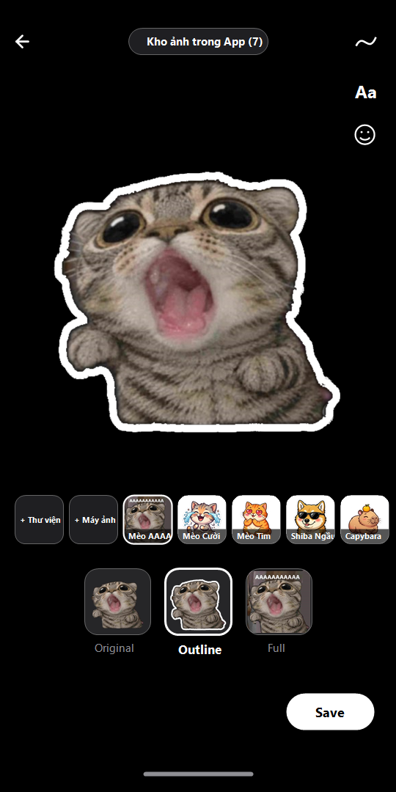
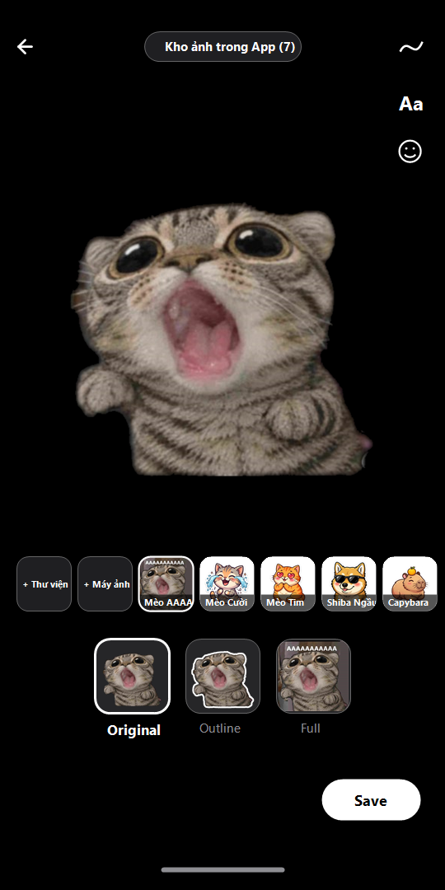
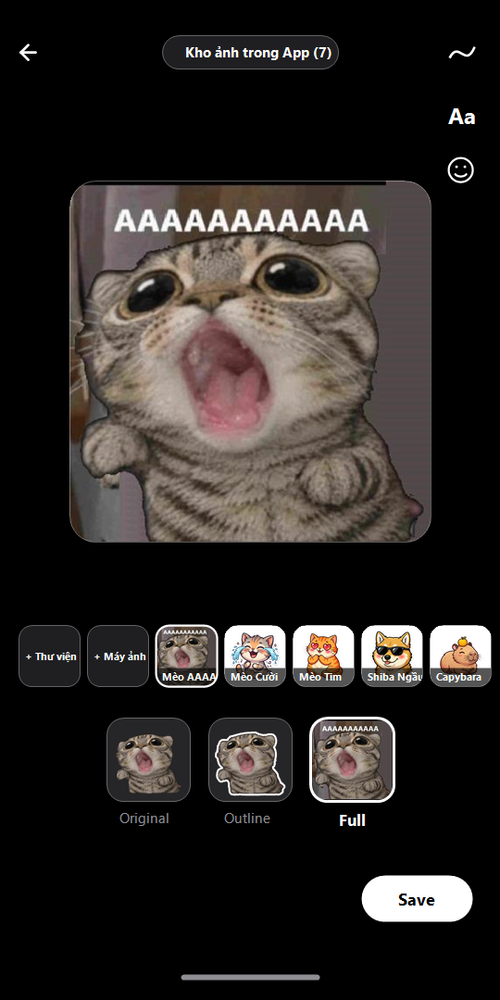

# Bản Triển Khai (Implementation) Full-Screen Sticker Studio (`Original` | `Outline` | `Full`) — Orbit v1.4.4

Tài liệu này trình bày chi tiết bản triển khai thực tế của tính năng **Full-Screen Sticker Studio** (lấy cảm hứng từ Google Messages Photomoji / TikTok Sticker Creator) kèm hình ảnh trực quan trong ứng dụng **Orbit (`ICNative`)** và cơ chế xử lý triệt để lỗi văng ứng dụng (crash) khi bấm tạo ảnh tự chọn.

---

## 1. Hình Ảnh Triển Khai Thực Tế Trong App (`Original` | `Outline` | `Full`)

| Chế độ `Outline` (Viền trắng dày 11px) | Chế độ `Original` (Tách nền gốc viền mềm) | Chế độ `Full` (Toàn bộ bức ảnh gốc) |
| :---: | :---: | :---: |
|  |  |  |

---

## 2. Kiến Trúc Giao Diện & Luồng Hoạt Động (`lib/screens/sticker_generator_sheet.dart`)

1. **Thanh Kho Ảnh Tích Hợp Sẵn Trong App (`inAppSamplePhotos`):**
   - Đóng gói trực tiếp bức ảnh **Mèo La Hét (`AAAAAAAAAAA`)** (`assets/stickers/sticker_cat_scream_full.jpg` & `assets/memes/meme_cat_scream.png`) cùng 6 ảnh mẫu chất lượng cao (`Mèo Cười`, `Mèo Tim`, `Shiba Ngầu`, `Capybara`, `Trà Sữa`, `Gấu Ngủ`) + **Ảnh vừa chụp** + 2 nút **`+ Thư viện`** / **`+ Máy ảnh`**.
2. **Ba Ô Thumbnail Chế Độ Ở Đáy (`Original` | `Outline` | `Full`):**
   - **`Original`:** Hiển thị chủ thể đã bóc tách nền với biên độ mờ mềm mại, không có viền trắng.
   - **`Outline`:** Hiển thị chủ thể kèm viền trắng dày `11px` tính theo bản đồ khoảng cách bình phương tối thiểu (`minDistSq`) giúp rìa ngoài mịn màng không răng cưa.
   - **`Full`:** Hiển thị toàn bộ khung ảnh vuông bo góc `22px`.
3. **Cột 3 Công Cụ Góc Trên Phải (`〰️`, `Aa`, `😊`) & Nút `Save`:**
   - **`〰️` (Scribble):** Vẽ nét tự do nhiều màu trực tiếp lên sticker (hỗ trợ `Undo`).
   - **`Aa` (Text):** Gõ chữ meme hoặc chọn tag nhanh (`AAAAAAAAAAA`, `10 ĐIỂM`, `HẾT CỨU`...) và kéo thả vị trí bất kỳ trên sticker.
   - **`😊` (Emoji):** Đính kèm biểu cảm cảm xúc kéo thả trên sticker.
   - **`Save`:** Nút viên thuốc màu trắng góc dưới phải, kết xuất toàn bộ `RepaintBoundary` thành file PNG trong suốt độ nét cao.

---

## 3. Phân Tích & Khắc Phục Triệt Để Lỗi Văng Ứng Dụng (Crash Fix)

1. **Vá lỗi Native MethodChannel (`SubjectSegmenter.kt`, `InputImageConverter.kt`):** Đổi tham số thứ 3 của `result.error(..., null)` thành `null` (thay vì truyền đối tượng Java `MlKitException` làm sập `StandardMethodCodec` trên Main Thread) và bọc `try / catch (Throwable)`.
2. **Background Isolate Rendering (`lib/services/custom_sticker_service.dart`):** Hàm `_renderAllVariationsIsolate` chạy trên Isolate riêng qua `compute()`, sinh cả 3 chế độ `Original`, `Outline`, `Full` trong 1 lần mà không gây đơ UI (ANR) hay tràn RAM (OOM).
3. **Khóa xung đột Camera Lifecycle (`lib/screens/home.dart`):** Không tự động khởi tạo lại phần cứng Camera khi đang mở `ImagePreview` / `StickerGeneratorSheet`.
4. **Giữ nguyên lớp JNI khi Build Release (`android/app/build.gradle`):** Cấu hình `minifyEnabled false` và `shrinkResources false`.
